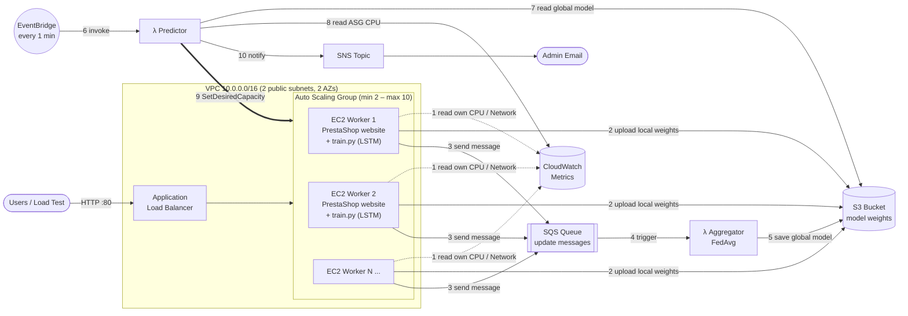
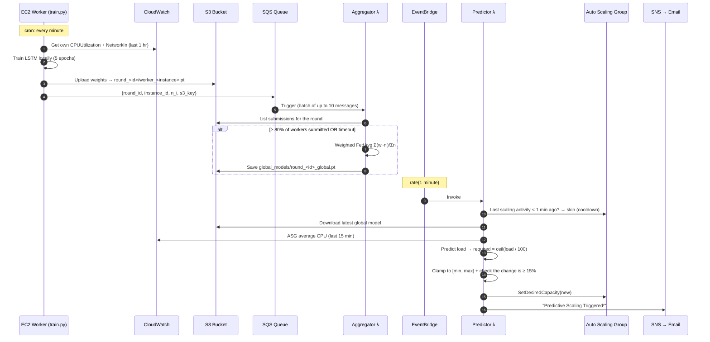
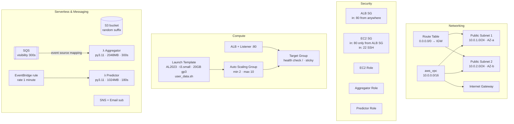

# Federated Learning–Based Predictive Auto-Scaling on AWS

> Instead of scaling servers **after** CPU spikes (reactive scaling), this project **predicts** upcoming load with an LSTM model trained using **Federated Learning** across the servers themselves, and scales the Auto Scaling Group **before** the load hits.

Everything is deployed with **Terraform** (Infrastructure as Code) in the `ap-south-1` (Mumbai) region.

---

## Table of Contents

1. [The Problem](#1-the-problem)
2. [Our Solution in One Picture](#2-our-solution-in-one-picture)
3. [How It Works – Step by Step](#3-how-it-works--step-by-step)
4. [Infrastructure (Detailed)](#4-infrastructure-detailed)
5. [Deployment Guide](#5-deployment-guide)
6. [Load Testing / Demo](#6-load-testing--demo)
7. [Project Structure](#7-project-structure)
8. [Tech Stack](#8-tech-stack)
9. [Current Limitations & Future Work](#9-current-limitations--future-work)
10. [Design Decisions](#10-design-decisions)
11. [Team](#11-team)

---

## 1. The Problem

Standard AWS auto-scaling is **reactive**:

```
Traffic spike → CPU goes above 70% → alarm fires → new EC2 starts (2–5 min boot) → users already faced slowness
```

New instances take minutes to boot, so users feel the slowness before help arrives.

**Also:** if you train a prediction model, you normally have to ship all servers' metrics to one central place. **Federated Learning (FL)** avoids that: each server trains on its **own** data locally and only shares **model weights**, not raw data.

---

## 2. Our Solution in One Picture



There are two loops:

| Loop | Runs | What it does |
|---|---|---|
| **Learning loop** (steps 1–5) | Every minute on every EC2 (cron) | Each worker trains locally → Aggregator combines the weights into one **global model** |
| **Scaling loop** (steps 6–10) | Every minute (EventBridge) | Predictor uses the global model and recent CPU to decide how many instances are needed → scales the ASG → emails the admin |

---

## 3. How It Works – Step by Step



### 3.1 Federated Learning (worker side) – `src/ec2_fl_worker/train.py`
- Gets its own **instance ID** from the EC2 metadata service (IMDSv2).
- Pulls **its own** last-hour `CPUUtilization` and `NetworkIn` from CloudWatch → a sequence of 10 time steps × 2 features.
- Trains a small **LSTM** (64 hidden units → linear output) for 5 epochs.
- Uploads only the **weights** (`.pt`) to S3 and sends a small JSON message to SQS. **Raw metrics never leave the instance.** That is the core idea of FL.
- `round_id = round_<unix_time // 60>` → every worker in the same minute belongs to the same round.

### 3.2 Aggregation – `src/aggregator_lambda/lambda_function.py`
- Triggered automatically by **SQS** (event source mapping, batch size 10).
- Groups messages by round and counts submissions in S3.
- Aggregates when **≥ 80 %** of the expected workers have submitted, or when the round **times out** (60 s), so one slow worker can't block a round.
- **Weighted FedAvg:** `global_w = Σ (n_i / N) · w_i`. Workers with more data get more weight.
- Saves the result to `s3://<bucket>/global_models/`.

### 3.3 Prediction & Scaling – `src/predictor_lambda/lambda_function.py`
1. **Cooldown check**: if the ASG scaled less than 1 minute ago, it does nothing. This prevents flapping.
2. Loads the latest global model from S3.
3. Reads the last 15 min of **ASG-level CPU** from CloudWatch.
4. Predicts load → `required_instances = ceil(predicted_load / 100)` (100 = nominal capacity per instance).
5. **Clamps** the number to the ASG `min`/`max` (2–10).
6. **Anti-oscillation**: it only scales if the change is ≥ max(1, 15 % of current).
7. Calls `SetDesiredCapacity` and publishes an **SNS email** with the reason.

---

## 4. Infrastructure (Detailed)

> All infrastructure is defined in `terraform/main.tf`, `terraform/variables.tf` and `terraform/user_data.sh`.

### 4.1 Why Terraform?
- **Repeatable**: `terraform apply` builds the whole system (~40 resources) in minutes. `terraform destroy` removes it, so nothing is left running to cost money.
- **Version-controlled**: the infrastructure is code, reviewed like code.
- **Dependency graph**: Terraform works out the creation order automatically. For example, the S3 bucket name is injected into the EC2 user-data and the Lambda env vars.

### 4.2 Resource Map



### 4.3 Networking
| Resource | Config | Why |
|---|---|---|
| **VPC** | `10.0.0.0/16`, DNS support + hostnames on | Isolated private network for the project |
| **2 Public Subnets** | `10.0.1.0/24`, `10.0.2.0/24`, each in a **different Availability Zone** | An ALB **requires** at least 2 AZs, and it gives **high availability**: if one AZ fails, the other keeps serving |
| **Internet Gateway** + **Route Table** (`0.0.0.0/0 → IGW`) | Attached to both subnets | Lets instances download packages (yum, pip, Docker images) and lets users reach the ALB |
| `map_public_ip_on_launch = true` | | Instances get public IPs, so no NAT Gateway is needed (saves ~$32/month) |

### 4.4 Security Groups (firewalls)
| SG | Inbound | Outbound | Reasoning |
|---|---|---|---|
| **ALB SG** | TCP 80 from `0.0.0.0/0` | All | Public entry point |
| **EC2 SG** | TCP 80 **only from the ALB SG** · TCP 22 (SSH, debugging) | All | Users **cannot** hit an instance directly. All traffic must go through the load balancer (**SG chaining**) |

### 4.5 IAM – Least Privilege
Each component gets its **own role** with only the permissions it needs. **No access keys are stored anywhere.** EC2 uses an **Instance Profile** and the Lambdas use **execution roles**, so the AWS SDK picks up temporary credentials automatically.

| Role | Allowed | Why |
|---|---|---|
| **EC2 Worker** | `s3:Put/Get/ListBucket` (our bucket only), `sqs:SendMessage` (our queue only), `cloudwatch:GetMetricStatistics/PutMetricData` | Upload weights, notify aggregator, read own metrics |
| **Aggregator λ** | S3 read/write (our bucket), `sqs:Receive/Delete/GetQueueAttributes`, CloudWatch Logs | Consume queue, combine models |
| **Predictor λ** | S3 read-only, `cloudwatch:GetMetricStatistics`, `autoscaling:SetDesiredCapacity/Describe*`, `sns:Publish` (our topic), Logs | The only component allowed to **change capacity** |

### 4.6 Load Balancer
- **Application Load Balancer** (Layer 7, internet-facing) across both subnets.
- **Listener** on port 80 → forwards to the **Target Group**.
- **Health check**: `GET /` every 30 s, expects 200–399, 3 successes = healthy, 3 failures = unhealthy. Unhealthy instances stop receiving traffic.
- **Sticky sessions** (`lb_cookie`, 24 h): a user stays on the same instance. This is needed because PrestaShop keeps session/cart state on the server.
- The ASG registers new instances with the target group **automatically** (`target_group_arns`).

### 4.7 Auto Scaling Group & Launch Template
- **Launch Template**: latest **Amazon Linux 2023** AMI (looked up dynamically via `data "aws_ami"`), `t3.small`, 20 GB `gp3` disk, IAM instance profile, and `user_data.sh`.
- **ASG**: min **2**, max **10**, desired starts at 2, spread over both AZs.
- **No CloudWatch alarm / target-tracking policies.** Scaling is driven **only by our Predictor Lambda** calling `SetDesiredCapacity`. That's the whole point: predictive instead of reactive.
- **Instance refresh (Rolling)**: when the launch template changes (e.g. new `train.py`), Terraform rolls out new instances automatically.

### 4.8 EC2 Bootstrapping – `user_data.sh`
This runs once when every new instance boots. That makes each instance **self-configuring**, which is what allows the ASG to add servers with no manual work:

1. **Creates 2 GB swap**. `t3.small` has only 2 GB RAM, and installing PyTorch + running MariaDB caused **OOM kills** without it.
2. Installs Python, gcc and Docker, and starts Docker.
3. Writes `docker-compose.yml` and starts the **PrestaShop e-commerce website + MariaDB** (the "real" workload users hit). Terraform passes in the ALB DNS name so links work.
4. Creates a Python **venv** and installs `boto3`, `pandas` and **CPU-only PyTorch** (much smaller than the GPU build).
5. Writes `train.py`. Terraform injects the file's content directly via `templatefile()`, so no S3 download or git clone is needed.
6. Exports `S3_BUCKET_NAME` / `SQS_QUEUE_URL` (Terraform fills in the real values).
7. Adds a **cron job** to run training **every minute**, and also runs it once immediately.

### 4.9 S3, SQS, SNS
| Service | Config | Role in the system |
|---|---|---|
| **S3** | Name `fl-auto-scaling-models-<random hex>` (bucket names are globally unique), `force_destroy = true` (so `terraform destroy` works even with objects inside) | Stores local weights `round_x/worker_i.pt` and global models `global_models/` |
| **SQS** | Visibility timeout **300 s** = Aggregator timeout | **Decouples** workers from the aggregator. Workers fire-and-forget; messages are buffered if the Lambda is busy. The visibility timeout must be ≥ the Lambda timeout, otherwise a message could be processed twice |
| **SNS** | Email subscription (`var.sns_email`) | Human notification on every scaling event |

### 4.10 Lambda & EventBridge
| Function | Trigger | Memory / Timeout | Env vars (injected by Terraform) |
|---|---|---|---|
| **Aggregator** | SQS event source mapping, batch 10 | 2048 MB / 300 s | `S3_BUCKET_NAME`, `SQS_QUEUE_URL` |
| **Predictor** | EventBridge `rate(1 minute)` | 1024 MB / 180 s | `S3_BUCKET_NAME`, `ASG_NAME`, `SNS_TOPIC_ARN` |

- The code is zipped automatically by Terraform's `archive_file` data source. `source_code_hash` means Lambda is **only redeployed when the code changes**.
- `aws_lambda_permission` grants EventBridge permission to invoke the Predictor.

### 4.11 Configurable Variables – `variables.tf`
| Variable | Default | Meaning |
|---|---|---|
| `aws_region` | `ap-south-1` | Deployment region |
| `project_name` | `fl-auto-scaling` | Prefix for every resource name |
| `vpc_cidr` | `10.0.0.0/16` | VPC range |
| `public_subnet_cidrs` | `["10.0.1.0/24","10.0.2.0/24"]` | One per AZ |
| `instance_type` | `t3.small` | Worker size |
| `min_capacity` / `max_capacity` | `2` / `10` | ASG limits |
| `sns_email` | `admin@example.com` | **Change this** to receive alerts |

---

## 5. Deployment Guide

### Prerequisites
- AWS account + AWS CLI configured (`aws configure`)
- Terraform ≥ 1.5

### Steps
```bash
cd terraform
terraform init                                   # download AWS, random, archive providers
terraform plan  -var="sns_email=you@example.com" # preview ~40 resources
terraform apply -var="sns_email=you@example.com" # create everything
```
1. **Confirm the SNS subscription** email AWS sends you.
2. Wait ~5–8 min for instances to boot (Docker + PyTorch install).
3. Open the ALB DNS name (EC2 → Load Balancers) in a browser → PrestaShop site.

### Verify it's working
```bash
# Worker log on an instance (SSH in)
tail -f /tmp/worker.log            # "Successfully uploaded weights for round_..."
cat /var/log/user-data.log         # bootstrap log

# S3 contents
aws s3 ls s3://<bucket>/ --recursive

# Lambda logs
aws logs tail /aws/lambda/fl-auto-scaling-aggregator --follow
aws logs tail /aws/lambda/fl-auto-scaling-predictor  --follow
```

### Tear down (avoid charges!)
```bash
terraform destroy -var="sns_email=you@example.com"
```

---

## 6. Load Testing / Demo

`load_test.py` starts **300 concurrent threads**, each hitting the ALB in a loop.

```bash
# set ALB_URL inside the file to your ALB DNS first
python load_test.py
```

**What you see:**
1. CPU on the instances rises (CloudWatch).
2. Within ~1–2 min the Predictor Lambda detects it and scales **2 → 10** instances.
3. An email arrives: *"Predictive Scaling Triggered! Current Capacity: 2, New Capacity: 10"*.
4. New instances boot, pass health checks and join the ALB.
5. Stop the test → CPU falls → after cooldown it scales back down to **2**.

---

## 7. Project Structure

```
.
├── terraform/                    # Infrastructure as Code
│   ├── main.tf                   # all AWS resources
│   ├── variables.tf              # configurable inputs
│   ├── user_data.sh              # EC2 bootstrap script
│   └── .terraform.lock.hcl       # pinned provider versions
├── src/
│   ├── ec2_fl_worker/train.py            # local LSTM training on each EC2
│   ├── aggregator_lambda/lambda_function.py  # FedAvg aggregation
│   ├── predictor_lambda/lambda_function.py   # prediction + scaling decision
│   └── website/                          # PrestaShop compose + status page
├── load_test.py                  # traffic generator for the demo
└── README.md
```

---

## 8. Tech Stack

| Layer | Technology |
|---|---|
| IaC | Terraform (AWS, random, archive providers) |
| Cloud | AWS: VPC, EC2, ASG, ALB, S3, SQS, SNS, Lambda, EventBridge, CloudWatch, IAM |
| ML | PyTorch (LSTM), Federated Averaging |
| Language | Python 3.11, Bash |
| Workload | Docker Compose → PrestaShop + MariaDB |

---

## 9. Current Limitations & Future Work

| Limitation | Why | Improvement |
|---|---|---|
| Lambdas can't import **PyTorch** (package > 250 MB zip limit), so the Predictor falls back to a **CPU-threshold heuristic** (CPU > 10 % → 10 instances, else 2) and the Aggregator writes a placeholder global model | AWS Lambda deployment size limit | Package the Lambdas as **container images** (10 GB limit) or use a Lambda Layer with a slim build |
| Training labels are random placeholders | No labelled "future load" yet | Use the *next* time-step's CPU as the label (true time-series forecasting) |
| Public subnets + SSH open to `0.0.0.0/0` | Simpler/cheaper for a demo | Private subnets + NAT Gateway, SSM Session Manager instead of SSH |
| HTTP only | Demo | ACM certificate + HTTPS listener |
| Local Terraform state | Single developer | **S3 remote backend + DynamoDB state locking** for team use |
| No SQS dead-letter queue | | Add a DLQ for failed messages |

---

## 10. Design Decisions

Why the infrastructure is built the way it is:

| Question | Answer |
|---|---|
| Why two subnets / AZs? | The ALB requires ≥ 2 AZs, and it gives high availability if one AZ goes down. |
| Why SQS between EC2 and Lambda? | **Decoupling + buffering.** Workers don't wait for the aggregator; if the Lambda is busy or fails, messages aren't lost. |
| Why is the SQS visibility timeout 300 s? | It must be ≥ the Lambda timeout (300 s), otherwise the message reappears and is processed twice. |
| How do EC2/Lambda get AWS credentials? | IAM roles (instance profile / execution role) give temporary credentials. No hard-coded keys. |
| Can users access EC2 directly? | No. The EC2 SG only accepts port 80 from the ALB's security group. |
| How do new instances get configured? | `user_data.sh` runs at boot: installs Docker + PyTorch, starts the website, sets up the cron training job. Fully automatic. |
| How does the code reach the instances? | Terraform's `templatefile()` embeds `train.py` and `docker-compose.yml` into the user-data. |
| How do you avoid scaling up/down repeatedly (flapping)? | 1-minute cooldown check + only scale if the change is ≥ 15 % + clamped to min/max. |
| Why no CloudWatch alarms on the ASG? | That would be reactive scaling. Our Predictor Lambda is the only thing that changes capacity. |
| Why the swap file? | `t3.small` has 2 GB RAM. PyTorch install + MariaDB got OOM-killed, and 2 GB of swap fixed it. |
| Why the random suffix on the S3 bucket? | Bucket names are globally unique across all AWS accounts. |
| How is the Lambda code deployed? | `archive_file` zips it, and `source_code_hash` redeploys only when the code changes. |
| What is FedAvg? | The weighted average of the workers' weights: `Σ(nᵢ/N)·wᵢ`. Workers with more samples count more. |

---

## 11. Team

| Member | Responsibility |
|---|---|
| *Jaikiran* | **Cloud Infrastructure**: Terraform, networking, IAM, ALB/ASG, Lambda/SQS/SNS/EventBridge wiring, EC2 bootstrapping |
| *Yeswanth Sai* | Federated Learning / ML model |
| *Yeswanth Sai* | Aggregation & prediction logic |
| *Mano & Ajith* | Website & load testing |
